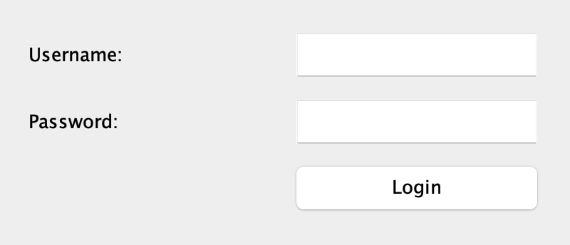
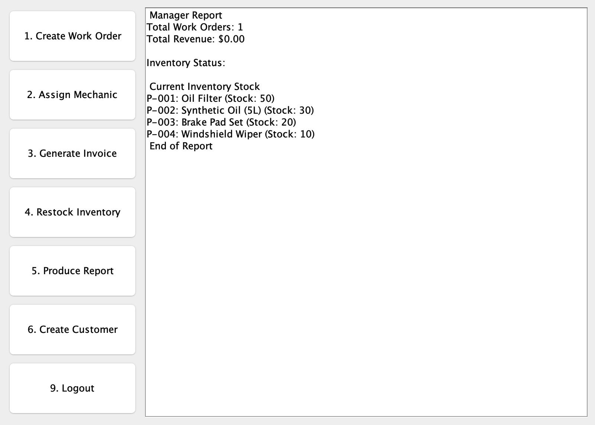
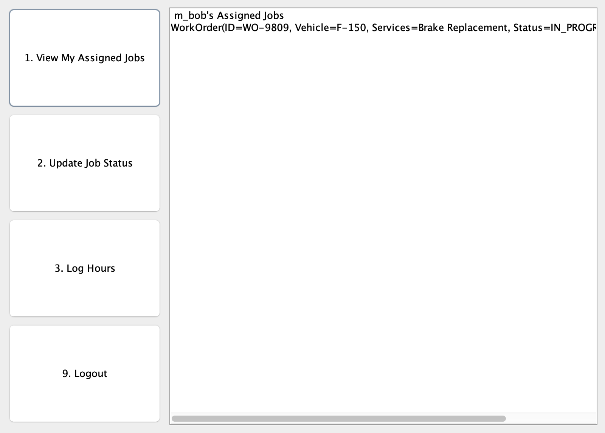
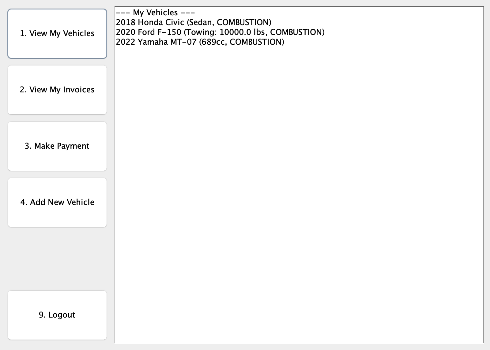

# Auto Repair Shop

A desktop management system for an auto repair shop, written in Java with a Swing GUI.
Managers, mechanics and customers each log in to their own dashboard and move a repair
job through its full life cycle: **work order → mechanic assignment → service → invoice → payment**.

Built as a high-school object-oriented programming final project (November 2025) by
**Eric Huo** and **Eric Chen**.



## Features

The program has three user roles. Each role gets its own dashboard after login.

### Manager
- **Create work orders**: pick a customer, one of their vehicles and one or more services. The parts each service needs are reserved from inventory.
- **Assign mechanics**: assign a mechanic to an open work order. The order moves to `IN_PROGRESS`.
- **Generate invoices**: bill a finished (`DONE`) work order as parts + labour ($120/h) + tax. The order is then `CLOSED`.
- **Restock inventory**: add stock to an existing part.
- **Create customers**: register a new customer account. It is saved to `data/users.csv`.
- **Produce report**: show total work orders, revenue from paid invoices and current stock levels.

### Mechanic
- **View assigned jobs**: list the work orders assigned to this mechanic.
- **Update job status**: mark a service as performed and record the part and quantity used. When every service on the order is done, the order becomes `DONE`.
- **Log hours**: add labour hours to a work order.

### Customer
- **View my vehicles**: list the customer's cars, trucks and motorbikes.
- **Add new vehicle**: register a `Car`, `Truck` or `Motorbike`. It is saved to `data/vehicles.csv`.
- **View my invoices**: list the customer's invoices and their status (`UNPAID` / `PAID`).
- **Make payment**: pay an unpaid invoice.

## Screenshots

| Manager | Mechanic | Customer |
|---|---|---|
|  |  |  |

## Tech stack

- **Java 8+**, standard library only. There are no external dependencies.
- **Swing** for the GUI (`JFrame`, `JPanel`, `JOptionPane`).
- **CSV files** for data storage.
- OOP design: an abstract `User` class (`Manager`, `Mechanic`, `Customer`) and an abstract `Vehicle` class (`Car`, `Truck`, `Motorbike`), with `WorkOrder` as the central class. See the [UML diagram](docs/uml-diagram.png).

## Getting started

### Requirements
A JDK, version 8 or newer. Check that it is installed:

```bash
java -version
javac -version
```

### Run (macOS / Linux)

```bash
git clone https://github.com/huoke7/Auto-Repair-Shop.git
cd Auto-Repair-Shop
./run.sh
```

### Run manually (any OS, including Windows)

Run these commands from the project root. The program reads the CSV files from `data/` using
paths relative to the current directory.

```bash
javac -d out src/*.java
java -cp out AutoShop
```

### Demo accounts

All demo accounts use the password `pass`.

| Role | Username |
|---|---|
| Manager | `a_eric` |
| Mechanic | `m_bob`, `m_ken` |
| Customer | `c_jane`, `c_jeff`, `c_harry`, `c_joe` |

### Try a full repair cycle

1. Log in as `a_eric`. Choose **Create Work Order** for customer `c_jane`, vehicle `VIN123` and service `S-01` (oil change), then type `done`. Write down the work order ID it prints, for example `WO-1234`.
2. Choose **Assign Mechanic**, enter that work order ID and the mechanic `m_bob`, then **Logout**.
3. Log in as `m_bob`. Choose **Update Job Status** and enter the work order ID, service `S-01`, part `P-001` and quantity `1`. The work order becomes `DONE`. Then **Logout**.
4. Log in as `a_eric`. Choose **Generate Invoice** for the work order, with a tax rate such as `0.13`.
5. Log in as `c_jane`. Choose **View My Invoices**, then **Make Payment**.

Work orders and invoices exist only in memory. They are lost when you close the window, so do the whole cycle in one run.

## Project structure

```
Auto-Repair-Shop/
├── src/                         Java source code (default package)
│   ├── AutoShop.java            Entry point (main): loads data, keeps all shop state
│   ├── LoginFrame.java          Login window
│   ├── ManagerDashboardPanel.java
│   ├── MechanicDashboardPanel.java
│   ├── CustomerDashboardPanel.java
│   ├── User.java                Abstract user ─┬─ Manager.java
│   │                                           ├─ Mechanic.java
│   │                                           └─ Customer.java
│   ├── Vehicle.java             Abstract vehicle ─┬─ Car.java
│   │                                              ├─ Truck.java
│   │                                              └─ Motorbike.java
│   ├── WorkOrder.java           A repair job: customer + vehicle + services
│   ├── Service.java             A catalog service with its required parts
│   ├── PartRequirement.java     Part number + quantity needed by a service
│   ├── Part.java, Inventory.java
│   ├── Invoice.java
│   └── Role.java, WorkStatus.java, InvoiceStatus.java, Powertrain.java   (constants)
├── data/                        CSV data loaded at startup
│   ├── users.csv                role,username,password,email
│   ├── vehicles.csv             type,VIN,make,model,year,powertrain,owner,extra
│   ├── services.csv             id,description,hours,powertrain|null,part:qty;part:qty
│   └── parts.csv                partNumber,description,stock,price
├── docs/
│   ├── uml-diagram.png          Class diagram
│   └── screenshots/
├── run.sh                       Compile and run
└── README.md
```

## Known limitations

This is a school project, so it has some simplifications:

- Passwords are stored in plain text in `data/users.csv`.
- Only users and vehicles are saved back to the CSV files. Work orders, invoices and inventory changes are lost when the program closes.
- Running the program can change `data/users.csv` and `data/vehicles.csv`. To reset the demo data, run `git checkout data/`.
- The "completed" flag is stored on the shared catalog `Service` object. A service finished on one work order therefore shows as finished on every work order that uses it during the same run.
- Work order IDs are random (`WO-` followed by a number from 0 to 9999), so two orders could get the same ID.

## Authors

- Eric Huo ([@huoke7](https://github.com/huoke7))
- Eric Chen
